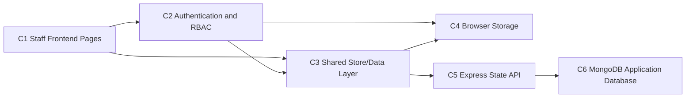

# Development Activity 4 — Dependency Mapping and Failure Analysis

## Project

**Project Name:** Cafe Management System (CMS)  
**Student:** M. Usman (22L-7991)  
**Architecture reviewed:** HTML/CSS/vanilla JavaScript staff application, shared browser data layer, Node.js/Express state API, and MongoDB persistence.

The matrix below models **direct functional dependencies**. An arrow always points from a component to the component it requires.

## Part 1 — System components

| Symbol | Component name | Main responsibility |
|---|---|---|
| C1 | Staff Frontend Pages | Provide the waiter, kitchen, cashier, manager, and admin screens for orders, reservations, kitchen status, billing, inventory, reports, users, and audit review. |
| C2 | Authentication and RBAC | Validates sign-in input, creates/clears the staff session, checks active accounts and roles, protects pages, and builds role-specific navigation. |
| C3 | Shared Store/Data Layer | Acts as the application data layer. It validates and updates users, menu items, inventory, orders, bills, reservations, and audit records, and publishes changes to pages. |
| C4 | Browser Storage | Provides `sessionStorage` for the current session and `localStorage` for the offline application-state cache and kitchen heartbeat. |
| C5 | Express State API | Serves static files and exposes `/api/health`, `GET /api/state`, and `PUT /api/state` for application-state synchronization. |
| C6 | MongoDB Application Database | Persists the CafeMS application-state document in the `application_state` collection and answers API health checks. |

**Scope note:** Audit logging is part of C3 because the implemented `Store.log` function creates the hash-chained audit records. It is not listed as a separate service because the project has no independent audit server.

## Part 2 — Direct dependencies

| Component | Directly depends on | Reason |
|---|---|---|
| C1 — Staff Frontend Pages | C2, C3 | Pages require the authenticated role/session guard before opening and require Store operations to read and change application data. |
| C2 — Authentication and RBAC | C3, C4 | Login identifies users through `Store.findUser`; the current session is written to and read from browser `sessionStorage`. |
| C3 — Shared Store/Data Layer | C4, C5 | Store uses `localStorage` as the offline cache and uses the Express API when the application is served over HTTP/HTTPS. |
| C4 — Browser Storage | None | Browser storage is a platform capability used by the application; it does not require another CafeMS component. |
| C5 — Express State API | C6 | The API connects to MongoDB, reads/writes the `application_state` collection, and uses MongoDB for `/api/health`. |
| C6 — MongoDB Application Database | None | MongoDB is the persistence endpoint in this simplified model. |

## Part 3 — Dependency matrix

Rows are the components that depend on other components. Columns are the components on which they depend. A `1` means a direct dependency; a `0` means no direct dependency. The diagonal is `0`.

| Row / Column | C1 | C2 | C3 | C4 | C5 | C6 |
|---|---:|---:|---:|---:|---:|---:|
| **C1 — Staff Frontend Pages** | 0 | 1 | 1 | 0 | 0 | 0 |
| **C2 — Authentication and RBAC** | 0 | 0 | 1 | 1 | 0 | 0 |
| **C3 — Shared Store/Data Layer** | 0 | 0 | 0 | 1 | 1 | 0 |
| **C4 — Browser Storage** | 0 | 0 | 0 | 0 | 0 | 0 |
| **C5 — Express State API** | 0 | 0 | 0 | 0 | 0 | 1 |
| **C6 — MongoDB Application Database** | 0 | 0 | 0 | 0 | 0 | 0 |

### Dependency paths

The important direct and indirect paths are:

- `C1 → C2 → C3 → C5 → C6`
- `C1 → C3 → C4`
- `C2 → C4`
- `C3 → C4`
- `C3 → C5 → C6`

The `C3 → C4` path is the reason that the prototype can continue using cached state when MongoDB is unavailable. The cache reduces the impact of a database failure, but it does not remove the risk of unsynchronized writes.

## Part 4 — Component failure analysis

### Failure Scenario 1

**Component that fails:** C3 — Shared Store/Data Layer

**Which components depend directly on it?**

- C1 — Staff Frontend Pages
- C2 — Authentication and RBAC

**Which additional components could be affected through indirect dependencies?**

- C4 — Browser Storage may still contain data, but the pages no longer have the Store logic needed to interpret, validate, or update it.
- C5 and C6 may remain online, but they cannot be used by the frontend because C3 is the component that calls the API.

**Which system functions would be disrupted or degraded?**

- Staff login would not be able to identify the selected user.
- Page guards and role-specific navigation could not reliably validate the account or role.
- Orders, reservations, kitchen status, billing, inventory, reports, user administration, and audit-log views would not be able to read or commit domain data.
- Existing static/public pages could still load, and MongoDB itself could remain available, but the staff application would be effectively unavailable.

This is a high-impact application failure because C3 is the single shared data and business-rule boundary for every staff module.

### Failure Scenario 2

**Component that fails:** C6 — MongoDB Application Database

**Which components depend directly on it?**

- C5 — Express State API

**Which additional components could be affected through indirect dependencies?**

- C3 — Store synchronization requests to `GET /api/state` and `PUT /api/state` can fail through C5.
- C1 — Staff pages can receive stale data or lose newly synchronized data if the local cache is empty or incomplete.
- C2 — Authentication can be affected indirectly if the user directory has not been seeded into the local cache.

**Which system functions would be disrupted or degraded?**

- `/api/health` reports that MongoDB is unavailable.
- Server-backed reads and writes cannot be persisted.
- When a usable `localStorage` cache exists, the UI can continue operating offline and changes remain local; synchronization is degraded rather than the entire UI stopping.
- If there is no usable cache, the application cannot initialize the Store and staff functions will not work.
- Data entered during the outage may diverge between browsers unless a later synchronization/reconciliation mechanism is used.

## Part 5 — Critical component

**Selected Component:** C3 — Shared Store/Data Layer

**Which components depend directly on it?**

- C1 — Staff Frontend Pages
- C2 — Authentication and RBAC

**Why could its failure have a significant impact?**

C3 is the common integration point for every staff page and for login-time user identification. It contains the shared validation, state transitions, audit logging, role-sensitive data shaping, local-cache handling, and API synchronization used across the system. Its failure affects both access control and business operations, while a MongoDB failure can be partially isolated by the existing local cache. Therefore, C3 has the strongest combination of breadth and centrality in this matrix.

## Part 6 — Failure-handling strategy

**Component that may fail:** C6 — MongoDB Application Database

**Proposed strategy:**

1. Keep the current `localStorage` cache as an explicitly supported offline mode.
2. Show a clear non-sensitive warning when `/api/health` or a synchronization request fails: “Offline mode: changes are saved locally and will synchronize when the database is available.”
3. Add a durable pending-write queue in the Store for failed `PUT /api/state` operations, retry it with backoff when connectivity returns, and show a conflict/error state if the server rejects a queued update.
4. Monitor `/api/health` and alert the operator after repeated failures.
5. Back up the MongoDB `application_state` collection so the API can be restored without losing the latest known state.

**How would this reduce the impact of the failure?**

The cache and pending-write queue allow unaffected staff workflows to continue during a short database outage. The warning prevents staff from assuming that data is already server-persisted, while retries and backups reduce the chance of permanent data loss after recovery.

**Would the entire system need to stop?**

No. With a valid local cache, staff can continue taking orders, managing reservations, viewing existing data, and recording changes locally. Server synchronization, cross-browser consistency, and recovery-sensitive operations are degraded until MongoDB and the API are healthy. If the cache is missing or corrupt, the safe fallback is to disable write operations and show an informative recovery message rather than silently losing data.

## Part 7 — Dependency graph

The graph below represents the same direction as the matrix: each arrow points to the component being depended on.



Text equivalent:

```text
C1 Staff Frontend Pages ──► C2 Authentication/RBAC ──► C3 Shared Store/Data Layer
          │                         │                         │
          └─────────────────────────┘                         ├──► C4 Browser Storage
                                                            └──► C5 Express State API ──► C6 MongoDB
```

## Final reflection

Dependency mapping showed that the Shared Store is the most critical application component because both access control and every staff workflow rely on it. It also showed that MongoDB is important but can be partially isolated by the browser cache, while a failure of authentication or the Store would have a much broader effect. The analysis improves security thinking by making trust boundaries visible: role checks and validation must remain enforced in the data layer/server, not only in page controls.

