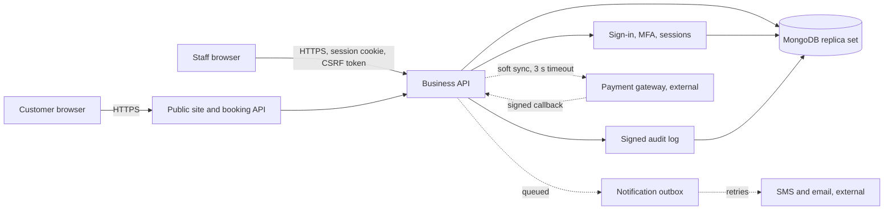
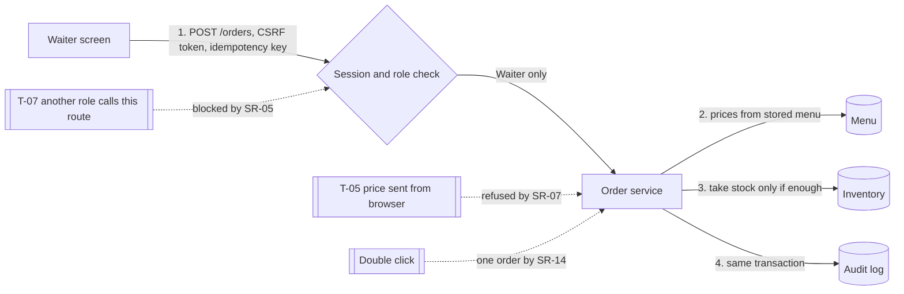
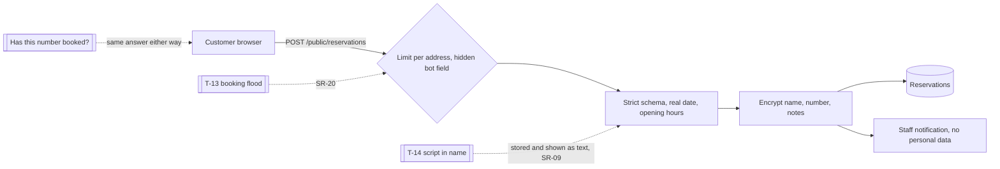
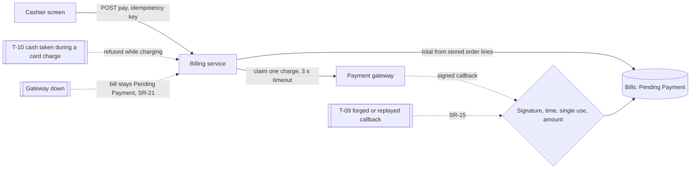

# Threat model

**The biggest threats to CafeMS come from insiders and from stolen staff passwords, not from outside attackers breaking in.** Staff already hold accounts, handle money and see customer details, so the strongest controls are on refunds, exports and customer numbers.

This model follows the Week 4 six-step process, then applies all four methodologies from the course: STRIDE, PASTA, OCTAVE and VAST. Threat IDs (T-01 to T-22) and requirement IDs (SR-01 to SR-28) are those in [TRACEABILITY.md](TRACEABILITY.md).

## The system

Trust boundaries sit at the browser (nothing it sends is trusted), the payment gateway (only signed, single-use callbacks are accepted) and the database (the app signs in with a least-privilege account).

## Step 1: Identify and categorise assets

| Asset | Category | Criticality | Why |
| --- | --- | --- | --- |
| Bills, payments and refunds | Financial | Critical | Money leaves the business through refunds |
| Staff credentials, MFA secrets and sessions | Credentials | Critical | Whoever holds them can act as that person |
| Audit log | Accountability | Critical | The only proof of who did what |
| Customer names, numbers and notes | Personal data | High | Privacy law and customer trust |
| Prices, menu and stock | Business data | High | Wrong prices lose money |
| Availability during service | Service | High | A down till stops the cafe |
| Public website | Reputation | Medium | Defacement harms the brand |

## Attackers

These are the six attacker types from the Attackers deck, judged for a cafe.

| Attacker | Motivation | Relevance to CafeMS | Main controls |
| --- | --- | --- | --- |
| **Insider** | Money, revenge or carelessness | Highest: staff already have access | Least privilege, masked numbers, second person for large refunds, export limits, signed audit log, alerts |
| **Cybercriminal** | Money and data | High: takes over accounts, reads customer data, skims cards | MFA, lockout, strict CSP with no third-party scripts, no card data stored, encrypted backups |
| **Script kiddie** | Fun, bragging rights | Medium: ready-made password-guessing and flooding tools | Rate limits, lockout, security headers, generic errors |
| **Hacktivist** | A cause | Low: defacement or flooding of the public page | Only listed files are served, strict CSP, rate limits, a read-only container |
| **Nation-state** | Strategic interest | Very low, except a poisoned software update | Locked dependencies, `npm audit`, self-hosted libraries, signed audit log |
| **Cyber terrorist** | Fear and disruption | Very low: a cafe is not critical infrastructure | Recorded as an accepted risk |

## Step 2: Identify threats with STRIDE

STRIDE asks six questions of each important component. The answers below are the threats that matter for each one.

| Component | Spoofing | Tampering | Repudiation | Information disclosure | Denial of service | Elevation of privilege |
| --- | --- | --- | --- | --- | --- | --- |
| **Sign-in and sessions** | Guessed password, stolen cookie (T-01, T-02) | Forged token (T-02) | Denying a sign-in (T-03) | Error messages reveal which accounts exist (T-18) | Locking staff out with failed attempts (T-13) | Using an old session after a role change (T-04) |
| **Orders and billing API** | Callback pretending to be the gateway (T-09) | Changed prices or totals, double charge (T-05, T-10) | Denying a discount (T-03) | Reading another waiter's order (T-06) | Request flood (T-13) | Waiter calling cashier routes (T-07) |
| **Refunds and approvals** | Approving one's own request | Changed refund amount (T-05) | Denying a refund (T-03) | Bill lists for past days (T-06) | Stuck approvals block refunds | One person issuing a large refund (T-11) |
| **Reservations and public site** | Fake bookings in a customer's name | Script in a name or note (T-14) | Denying a cancellation (T-03) | Finding out who has booked; full numbers (T-12) | Booking-form flood (T-13) | None found: the public API has no write access beyond requests |
| **Audit log** | Writing entries in another person's name | Editing or deleting entries (T-15) | Denying an action (T-03) | Customer data in log text (T-12) | Flooding the log to hide an attack (T-13) | App account rewriting history (T-17) |
| **Staff administration** | Using a stolen setup link | Changing another account | Denying a role change (T-03) | Hashes or secrets in responses (T-18) | Locking out the last Admin | Granting oneself Admin (T-04) |

**How each is answered:**
- **Spoofing:** MFA and lockout (SR-01, SR-03), signed single-use callbacks (SR-15), single-use setup links.
- **Tampering:** server-side totals and strict schemas (SR-07), idempotency (SR-14), CSP (SR-09).
- **Repudiation:** a signed audit log whose actor comes from the session (SR-11), and the person's own device signature on refunds, approvals, staff changes and erasure (SR-29).
- **Information disclosure:** encryption and masking (SR-12), ownership checks (SR-06), generic errors (SR-18).
- **Denial of service:** rate limits (SR-20), and alerts that merge repeats so noise cannot bury a real attack (SR-16).
- **Elevation of privilege:** one permission table checked on every route (SR-05), a second Admin for Admin changes (SR-10), least privilege in the database (SR-17).

## Step 3: Identify vulnerabilities

The audit of the prototype found 33 findings, and the review of Phases 1 to 4 found 16 more. Every code finding is fixed and has a test; findings 31 and 33, about the documents, are completed in Phase 7. The weaknesses that remain are design limits rather than defects:

| Weakness | Why it remains | Compensating control |
| --- | --- | --- |
| A shared cafe device keeps a session for up to 5 idle minutes | A shorter limit would sign staff out mid-order | Sign-out on the device, session list with revoke |
| Rate limits are kept in each app process's memory | Staff and public traffic go to separate processes, so counters are not shared | Account lockout is in the database and counts across both; a shared store is needed before adding more |
| Payment gateway and SMS are simulated | A real one needs a merchant account | Interfaces are signed and timed out as a real one would be |
| Anyone who knows a username can lock that account for 15 minutes | The course requires lockout after 3 failures, and it stops password guessing | Another Admin can unlock at once; the server's operator can recover an Admin; each lock raises an alert |
| A Manager can refund up to Rs 5,000 alone | A second person for every refund would stall service | Refund-spike alert, audit log, fresh code for every refund |

## Step 4: Assess and prioritise threats

Likelihood and impact come from the two scoring methods in the course; [RISK-AND-FAILURE-ANALYSIS.md](RISK-AND-FAILURE-ANALYSIS.md) has the full tables. The five highest risks on the prototype, in the order they were fixed:

| Rank | Threat | Prototype RPN | Now | Fixed in |
| --- | --- | --- | --- | --- |
| 1 | Login accepted any password (T-01) | 900 | 40 | Phase 1 |
| 2 | Database read or replaced without signing in (T-17) | 810 | 30 | Phase 1 |
| 3 | Role or ownership check bypassed (T-06, T-07) | 648 | 54 | Phase 2 |
| 4 | Bill totals tampered with (T-05) | 576 | 27 | Phase 2 |
| 5 | Two screens overwriting each other | 448 | 28 | Phase 2 |

## Step 5: Develop mitigations

Each threat is met by at least one of the 28 requirements. The controls are layered (defence in depth), so no single failure exposes an asset. For example, customer numbers are protected by:

1. The permission table, which keeps waiters away from full numbers.
2. Masking in every response.
3. Encryption at rest, so a stolen database is unreadable.
4. A rate limit and an audit entry for each full view, and for each search by number.
5. An alert when someone views or searches many numbers.

## Step 6: Validate and test the mitigations

| How | What it proves | Where |
| --- | --- | --- |
| 300+ automated tests, including attack tests | Each control works and the old attack fails | `tests/`, run by `npm test` |
| Traceability check | No requirement has lost its code or its tests | `npm run trace -- --check` |
| Failure injection | Stopped database, gateway timeout, failed messages, blocked audit writes, edited audit rows | `tests/resilience.test.js`, `tests/hardening.test.js` |
| Static and dynamic scanners | ESLint, Semgrep, CodeQL, gitleaks, Trivy, and OWASP ZAP (passive and active, signed in) | [SCAN-RESULTS.md](SCAN-RESULTS.md), and CI on every push |
| Load test | Staff keep working during a flood | [LOAD-TEST.md](LOAD-TEST.md) |
| Manual testing with Burp Suite | What the scanners miss | Phase 7 script, run by the student |

## PASTA: the card payment flow, all seven stages

PASTA starts from what the business needs and walks forward to a full attack and its impact. It is applied here to the riskiest flow: a card payment and its confirmation from the gateway.

1. **Define business objectives.** Every bill marked Paid has really been paid, for the right amount, exactly once. *Output:* payment records must match money actually received.
2. **Define the technical scope.** Cashier screen, `POST /billing/tables/:no/pay`, the gateway charge with its 3-second timeout, `POST /payments/callback`, and the `bills` collection. *Output:* scope is the payment and confirmation path.
3. **Decompose the application.** The cashier picks a method; the server works out the total from stored order lines and saves the bill as Pending Payment. It then claims the bill for one charge and calls the gateway. Separately, the gateway may post a signed callback later. Two inputs come from outside the server: the cashier's request and the gateway's callback. *Output:* the callback is the entry point an outsider can reach.
4. **Analyse threats.** A cybercriminal wants food or refunds without paying, and could forge or replay an "approved" callback. A dishonest insider wants to pocket cash by having a card payment approved twice. *Output:* threat scenario: a forged or replayed callback marks an unpaid bill as Paid.
5. **Analyse vulnerabilities.** A callback endpoint with no signature, no time limit or no record of what it has already seen would accept a forgery or a copy. The Phase 1 to 4 review found the third gap: a copied callback was accepted again within five minutes. *Output:* vulnerability: missing single-use check on signed callbacks (now fixed).
6. **Model the attack.** The attacker captures one genuine approved callback for B-5001. While the bill is waiting again, they resend it unchanged. The signature and timestamp are still valid, so without a single-use check the bill becomes Paid. *Output:* attack path: capture, then replay within the window, then an unpaid bill is marked Paid.
7. **Analyse risk and impact.** The impact is lost revenue on every replayed bill and records that no longer match the bank. It also means a gap in the till's accountability. Replay needs network access to a real callback, so likelihood is low, but the effect is direct financial loss. *Output:* risk was medium, and is now low.

The controls that answer it:
- **Signed, recent and single-use:** each callback must carry an HMAC signature and a recent timestamp, and is accepted only once (SR-15).
- **Right amount:** the amount must match the stored bill.
- **One charge at a time:** only one charge can be in progress per bill.
- **Late approvals flagged:** an approval for a bill already settled another way is recorded and raises an alert.

## OCTAVE: what matters to the cafe, in three phases

OCTAVE looks at the cafe as an organisation: what it cannot afford to lose, and what to fix first.

**Phase 1: build asset-based threat profiles.**

| Critical asset | Criticality | Main threat |
| --- | --- | --- |
| Takings and refunds | Critical | Insider refunds or a forged payment |
| Staff accounts | Critical | Account takeover |
| Audit log | Critical | Altered to hide misuse |
| Customer details | High | Exposure or misuse by staff |
| Service during opening hours | High | Outage or flood |

**Phase 2: identify infrastructure vulnerabilities.**
- **Takings:** run through the business API and database. A weak point would be the payment callback or one person issuing large refunds.
- **Staff accounts:** depend on passwords and authenticator phones. A weak point is staff reusing passwords.
- **Audit log:** lives in the same database as everything else, so anyone with database rights could alter it. This is why the app account cannot change it, and why the chain is signed.
- **Customer details:** reachable through screens, exports and backups.
- **Service:** depends on one database, the main single point of failure (DB stops 5 services).

**Phase 3: develop the security strategy.**

| Asset | Risk | Priority | Strategy |
| --- | --- | --- | --- |
| Takings and refunds | Insider fraud, forged payment | Very high | Second person over Rs 5,000, fresh code for every refund, signed single-use callbacks, alerts |
| Staff accounts | Takeover | Very high | MFA for everyone, lockout, session list with revoke |
| Audit log | Tampering | Very high | Signed chain, append-only database account, 15-minute verification |
| Customer details | Exposure | High | Encryption, masking, export limits, 90-day retention |
| Service | Outage | High | Backups, rate limits, soft dependencies on outside services; the three-member database option, which CI proves by killing the primary |

## VAST: visual threat models per user story

VAST keeps threat modelling simple and visual, one diagram per user story, so it fits an agile workflow. Each diagram marks where a threat applies and which control stops it.

**User story 1: as a waiter, I take an order for my table.**

**User story 2: as a customer, I request a table online.**

**User story 3: as a cashier, I take a card payment.**

## What each method added

| Method | Question it answered for CafeMS | What it surfaced |
| --- | --- | --- |
| STRIDE | What type of threat applies to each component? | A full grid with no empty category; repudiation led to the signed audit log |
| PASTA | How would a real attack on payments work, and what would it cost? | The callback replay path, fixed by single-use callbacks |
| OCTAVE | What can the cafe least afford to lose? | Takings, accounts and the audit log come first; the database is the single point of failure |
| VAST | Where in each user story does a threat apply? | Diagrams the whole team can read, one per story |
